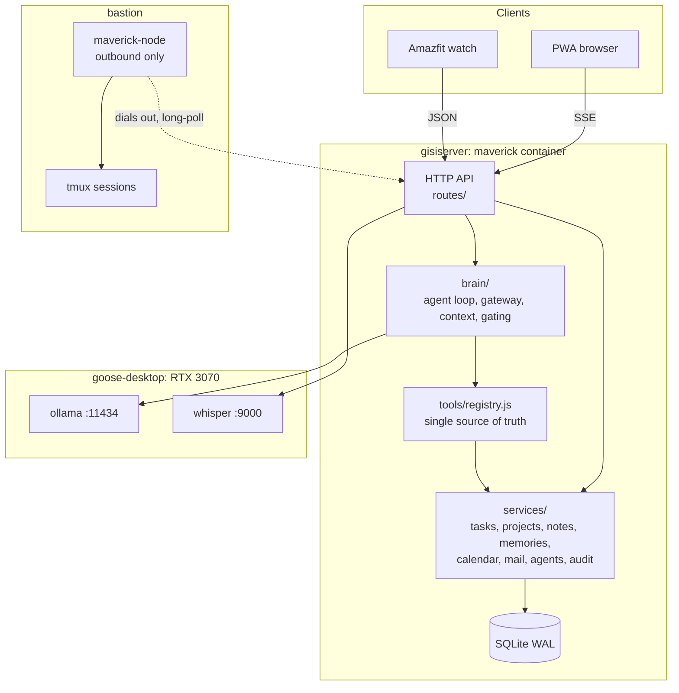
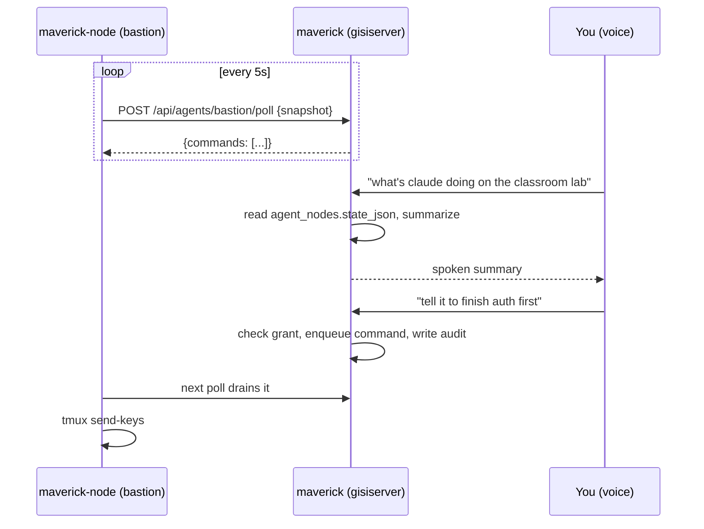
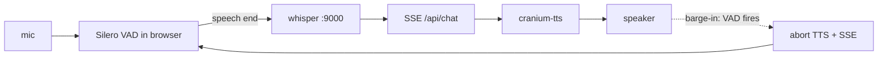

# Maverick overhaul plan

**Status:** in progress. Phases 0, 2, 3, 4, 5 and 8 are built and deployed; see section 12.
**Written:** 2026-08-23, against maverick as deployed on gisiserver.
**Supersedes nothing.** It absorbs `docs/LOCAL-BRAIN-SPEC.md` (still authoritative for the
brain internals) and extends it to cover the rest of the overhaul.

## 0. What this is for

Six things were asked for:

1. A real-time conversational assistant (streaming, not blocking).
2. A UI rework, principally spacing and layout.
3. One task surface combining charliework and goosework, with complete and note actions.
4. Voice control of the labs running on bastion, hands free.
5. Email drafting plus the ability to scan the inbox on request.
6. Whisper / WhisperFlow style dictation.

Three decisions were made before writing this:

| Decision | Choice | Consequence |
| --- | --- | --- |
| Brain | Hard local cutover to ollama on goose-desktop | Section 4. Anthropic leaves the runtime. |
| Bastion reachability | gisiserver has no route to bastion; bastion reaches gisiserver | Section 8. The tmux integration inverts into a reverse agent. |
| Task unification | Mirror both sources into maverick's DB with write-through | Section 7. |

## 1. Current-state assessment

Read off the running system on 2026-08-23.

### What exists and works

| Piece | State |
| --- | --- |
| App | `maverick` container, Node/Express, port 3000, `proxy` net, Caddy-proxied |
| Frontend | `public/` vanilla-JS SPA, no build step, 401 lines of `app.js` |
| DB | SQLite WAL at `/app/data/maverick.db` |
| Brain | `server/claude.js` spawns `claude -p` with an MCP stdio server, 120 s timeout |
| Tools | 21, defined once in `server/mcp-server.js` as a `TOOLS` array plus a `switch` |
| Auth | Google SSO for login; separate offline-consent flow per connected Google account |
| Google | Calendar read, Gmail **compose only**, Drive/Docs/Sheets/Slides read |
| STT | `maverick-whisper`, `ASR_MODEL=base`, `openai_whisper` engine, gisiserver CPU |
| Watch | Zepp OS mini program posting to `/api/device/*` with a static device token |
| Integrations | timeclock, charliework, bookmarks, containers; all env-gated, all fail closed |

### What is missing relative to the six asks

**No streaming.** `POST /api/chat` blocks for the whole turn. Perceived latency is the
entire turn, and multi-round tool turns look like a hang.

**Dictation is not Whisper in the browser.** `public/app.js` uses the Web Speech API
(`toggleMic`), which is Chrome/Safari only, ships audio to Google, is single-shot, and has
no VAD. The self-hosted Whisper service is reached only by the watch. So the browser path
is neither private nor hands free, which is exactly what ask 6 wants fixed.

**No path to bastion.** No `/bastion`, no host entry, no SSH alias, nothing in
`/gisiserver/ai/`. Tailscale carries only `gisiserver` (100.64.0.1) and `gisiremote`
(100.64.0.2). Confirmed: routing is one-way, bastion to gisiserver.

**Tasks come from charliework only.** goosework is not wired at all, and it cannot be:
its `/api/tasks` sits behind `requireAuth` (Google session) with no agent-token path.
That has to be added on the goosework side.

**Gmail is write-only-as-draft.** Scope set is `gmail.compose`. There is deliberately no
read scope, so ask 5's "scan my emails" is impossible without re-consent. See section 9.

**The UI rebuilds itself completely on every state change.** `render()` reassigns
`innerHTML` on the sidebar, topbar, view and chrome for any change at all, including each
keystroke-driven state update. This is the root cause of the spacing and feel problems, not
a symptom of them. Details in section 6.

### Security notes on the current build

Not defects, worth recording:

- The docker socket mount is commented out in `compose.yml` and `container_status` fails
  closed. Correct. Keep it that way.
- Timeclock writes never touch the model: the tool writes a `pending_changes` row and the
  real PATCH happens on user confirm. This rail is the pattern every new privileged tool
  should copy.
- `CLAUDE_CODE_OAUTH_TOKEN` is shared with cranium and jarvis. The cutover removes
  maverick's copy, which shrinks that token's blast radius by one service.
- `mcp-server.js` holds tool implementations and is spawned per turn, so it re-reads
  `spaces` each turn. Moving the implementations to a registry (section 3) keeps that
  behaviour and removes the per-turn subprocess.

## 2. Proposed architecture

A modular monolith inside the existing maverick container, plus the two GPU services on
goose-desktop and one new agent process on bastion. No new containers on gisiserver.



Four rules the layering exists to enforce:

1. **`services/` never imports `brain/`.** The platform works with the brain offline
   (spec section 15). Every route that reads or writes state has a non-AI HTTP path.
2. **`tools/registry.js` is the only definition of a tool.** `mcp-server.js` becomes a
   thin adapter over it and stays in the tree for debugging from a dev machine.
3. **Tool handlers call `services/`, never integrations directly.** The service layer owns
   permission checks, audit rows and the pending-confirm rail.
4. **Nothing dials into bastion.** The arrow points outward, always.

### Why not the microservice split the source spec sketched

The source spec allowed a modular monolith and preferred reusing infrastructure. maverick is
single-user, low write volume, and already deployed as one container with one SQLite file.
Splitting it into a task service, a knowledge service and a gateway would add six failure
modes and a network hop per tool call to solve a scaling problem that does not exist.
Revisit only if a second user appears.

## 3. Technology stack

Mostly what is already there, on purpose.

| Layer | Choice | Note |
| --- | --- | --- |
| Runtime | Node 20, Express | unchanged |
| DB | SQLite WAL, `better-sqlite3` | see below |
| Frontend | vanilla JS, no build step | unchanged; section 6 fixes the rendering, not the stack |
| Inference | ollama on goose-desktop | `qwen2.5:7b` pending bake-off |
| STT | faster-whisper `small` on the 3070 | replaces the CPU service |
| TTS | existing `cranium-tts` (Kokoro, OpenAI-compatible `/v1/audio/speech`) | reuse, do not duplicate |
| VAD | Silero VAD via `onnxruntime-web`, in the browser | ~2 MB, no server round trip to detect speech |
| Date parsing | `chrono-node` | per LOCAL-BRAIN-SPEC 8.5 |
| Bastion agent | Node, single file, systemd, no deps beyond stdlib | must be trivially auditable |

### SQLite, not Postgres

The source spec suggested Postgres with pgvector. Recommendation: stay on SQLite.

- maverick is one user with a handful of writes a minute. SQLite WAL is comfortably
  correct at this scale and it is what the live data is already in.
- A `postgres` container already runs on gisiserver, so the door stays open.
- Semantic search, when it is actually wanted, can come from the `sqlite-vec` extension
  without a migration. Do not build embeddings before there is a corpus worth searching;
  see section 4's VRAM note for why an embedding model is not free here.

Recorded as a decision so it does not get relitigated silently. If the task or note corpus
passes roughly 100k rows, or a second writer appears, revisit.

## 4. The model gateway and the cutover

The choice made was a hard cutover: qwen2.5:7b serves every turn, Claude leaves the
runtime, `server/claude.js` is deleted in the final phase.

The gateway is still built. Not as a hedge, but because the loop needs one seam to call:

```js
// server/brain/gateway.js
gateway.chat({ messages, tools, stream, options }) -> AsyncIterable<Event>
```

with one adapter behind it (`adapters/ollama.js`) selected by `BRAIN_PROVIDER`. Adding an
OpenAI-compatible or Anthropic adapter later is a file, not a refactor. The Claude path is
preserved at a git tag before deletion, per LOCAL-BRAIN-SPEC 12.2.

### The stated cost, recorded once

LOCAL-BRAIN-SPEC section 14 is accurate and applies in full. The turns most likely to
degrade are exactly asks 4 and 5: multi-step lab orchestration and inbox triage. Three
mitigations are built in rather than hoped for:

- Deterministic time resolution before the model sees the message (LOCAL-BRAIN-SPEC 8.5).
- Tool gating to at most 8 schemas per request (8.3).
- Argument validation with the error fed back as the tool result, so a wrong call retries
  against the real schema instead of failing the turn.

If the section 11.1 harness cannot clear 28 of 30 after the bake-off, that is the signal to
come back to this decision, not to loosen the gate.

### One model, not five

The source spec wanted separate conversational, coding, summarization, embedding and router
models. With 8 GB of VRAM and `OLLAMA_MAX_LOADED_MODELS=1`, a second resident model evicts
the first. So:

- **Router:** deterministic keyword matching, no model call. Already the plan in 8.3.
- **Summarizer:** the same chat model, called after the reply is sent so it never sits in
  the latency path.
- **Embeddings:** deferred. Loading `nomic-embed-text` alongside the chat model exceeds the
  budget. Revisit if the GPU is upgraded.

The gateway carries a `role` argument (`chat` | `summarize` | `embed`) from day one so this
resolves to configuration when hardware allows, not to code changes.

## 5. Data model

Additive migrations only, guarded with `PRAGMA table_info` checks the way `db.js` already
does it. Nothing existing is dropped, including the dead `cc_session_id`.

### New: conversation storage (LOCAL-BRAIN-SPEC 8.4)

`messages` (id, conversation_id, role, content, tool_calls, tool_name, created_at) plus
`conversations.summary` and `conversations.summary_upto`.

### New: unified tasks

```sql
CREATE TABLE tasks (
  id           TEXT PRIMARY KEY,          -- 'cw:<id>' or 'gw:<id>'
  source       TEXT NOT NULL,             -- 'charliework' | 'goosework' | 'local'
  source_id    TEXT,
  title        TEXT NOT NULL,
  notes        TEXT,
  status       TEXT NOT NULL DEFAULT 'open',
  priority     INTEGER,
  due_date     TEXT,                      -- YYYY-MM-DD
  category     TEXT,
  space        TEXT,                      -- maverick space key
  project_id   TEXT,
  parent_id    TEXT,
  created_at   TEXT, updated_at TEXT, completed_at TEXT,
  synced_at    TEXT,
  dirty        INTEGER NOT NULL DEFAULT 0 -- 1 = local edit not yet pushed
);
```

Sync contract, stated explicitly because mirroring is where this design can go wrong:

- **Pull:** poll each source every 60 s and on demand. Origin wins on conflict unless
  `dirty=1`.
- **Push:** a local edit sets `dirty=1` and enqueues a write-through job. On success, clear
  `dirty` and take the origin's response as truth. On failure, retry with backoff and
  surface the row as "not synced" in the UI rather than silently keeping a lie.
- **Deletes:** a row absent from the origin for two consecutive successful pulls is removed
  locally. One missed pull never deletes anything.
- **The UI never hides sync state.** A task shows its source badge, and an unsynced edit
  says so.

goosework needs a token-authenticated API to make this possible. See section 12, phase 3.

### New: projects, notes, bookmarks, decisions

`projects` as first-class objects with stable ids, and a generic `links` table
(`from_type`, `from_id`, `to_type`, `to_id`, `rel`) so a task, note, conversation, bookmark
or agent session can belong to a project without a column per relationship.

### New: audit

```sql
CREATE TABLE audit (
  id INTEGER PRIMARY KEY AUTOINCREMENT,
  ts TEXT DEFAULT (datetime('now')),
  actor TEXT,            -- 'user' | 'model' | 'system'
  session_id TEXT,
  conversation_id TEXT,
  tool TEXT,
  args_json TEXT,
  result_summary TEXT,
  tier TEXT,             -- 'read' | 'write' | 'privileged'
  confirmed INTEGER,     -- 0/1, whether a confirmation gate was crossed
  ok INTEGER,
  latency_ms INTEGER
);
```

Every tool invocation writes one row. This is the spine of section 10.

### New: agent nodes and command queue

```sql
CREATE TABLE agent_nodes (
  id TEXT PRIMARY KEY,          -- 'bastion'
  label TEXT, last_seen TEXT, state_json TEXT   -- last published tmux snapshot
);
CREATE TABLE agent_commands (
  id INTEGER PRIMARY KEY AUTOINCREMENT,
  node_id TEXT, target TEXT,    -- 'session:window.pane'
  kind TEXT,                    -- 'text' | 'key'
  payload TEXT,
  status TEXT,                  -- 'queued' | 'sent' | 'done' | 'rejected' | 'expired'
  requested_by TEXT, created_at TEXT, sent_at TEXT, result TEXT
);
CREATE TABLE agent_grants (
  node_id TEXT, target TEXT, expires_at TEXT, granted_by TEXT
);
```

### New: memory provenance

`memories` gains `source_type`, `source_id`, `confidence`. The source spec's "why does the
assistant think this" question needs an answer, and it is a foreign key, not a heuristic.

## 6. UI rework

The ask was spacing. The cause is architectural, so the fix is too.

### The actual problem

`render()` reassigns `innerHTML` on four containers for every state change. Consequences
visible today:

- The chat input is destroyed and recreated on each render, so `S.chatInput` has to be
  manually shuttled in and out and the caret position is lost.
- Scroll position is reset, then patched by `scrollChat()` calling `scrollIntoView`.
- The `fadeUp` animation on `.bubble` replays on every existing message each render.
- Streaming (section 11) is impossible without a full rebuild per token.

Spacing is ad hoc on top of that. `.scroll` pads 18px, `.head` pads `6px 2px 14px`,
`.chips` uses `margin:0 -18px` with matching padding to fake a bleed, and roughly forty
inline `style="..."` attributes in `app.js` carry one-off px values. There is no scale, so
nothing lines up.

### The fix

1. **A spacing scale.** `--s1: 4px` through `--s7: 48px` as the only permitted values, plus
   `--gutter` for the single horizontal page inset. Every inline px value in `app.js` moves
   to a class or a token. No exceptions, because one exception is how the current state
   happened.
2. **Chat gets its own layout.** Today it renders inside `.scroll`, inheriting dashboard
   padding and the shared bottom chrome. It becomes a distinct full-height flex column with
   its own scroll region, its own composer, and no dashboard gutter.
3. **Targeted DOM updates.** Keep the render-all path for view switches, where it is cheap
   and correct. Add direct DOM mutation for the three hot paths: appending a chat message,
   appending stream tokens to the live bubble, and toggling a task checkbox. The composer
   input stops being rebuilt at all.
4. **Remove the demo tiles.** Sleep, nutrition and finance are hardcoded fake numbers
   occupying half the home grid. They go behind `SHOW_DEMO_TILES=false` by default. The
   grid then holds real things: next event, tasks due, notifications, spaces, and the new
   agent-status tile.
5. **Voice states get real affordances.** Idle, listening, transcribing, thinking,
   speaking, and barge-in-available are six distinct states. The current mic button has two.

Explicitly out of scope: changing the Aureo visual identity. Colours, type and the
goldenrod-on-warm-black language stay. This is layout and rhythm work, not a redesign.

## 7. Tasks: charliework plus goosework

Per the mirror decision in section 0.

- `services/tasks.js` owns the unified table, the pull loop and the write-through queue.
- `integrations/charliework.js` stays as-is (it already works).
- `integrations/goosework.js` is new and needs the goosework side to grow an agent API.
- Tools become source-agnostic: `list_tasks`, `add_task`, `complete_task`,
  `reschedule_task`, `add_task_note`, filtered by `source`, `space`, `project` or `due`.
- The model never sees a raw origin id. It sees `cw:412` / `gw:88`, so a hallucinated id
  fails the schema check instead of hitting the wrong system.

`add_task_note` is new and covers the "add notes" half of ask 3. goosework stores markdown
notes natively; charliework has a `notes` field. Both map.

## 8. Bastion integration

**Routing is one-way.** maverick cannot reach bastion. So the agent runs on bastion and
dials out. This is a constraint that happens to produce the better design: maverick holds no
credentials to bastion, and bastion opens no inbound port.

### Shape



Long-poll rather than WebSocket for v1: one endpoint, trivially debuggable with curl,
survives a Caddy restart without reconnect logic, and 5 s of latency is invisible against a
coding agent's working pace.

### What the node publishes (read path, no permission needed)

Session list, window/pane list, per-pane `tmux display-message` activity flags, and a
configurable tail of `tmux capture-pane -p`. Default 200 lines, capped at 2000.

### What the node accepts (write path, privileged)

Two command kinds only:

- `text`: a UTF-8 string, sent with `tmux send-keys -l` (literal, so no key interpretation).
- `key`: one name from a fixed allowlist (`Enter`, `Escape`, `C-c`, `Up`, `Down`, `Tab`).

There is no `exec` kind and no shell. The node cannot be asked to run a command; it can only
type into a pane that a human already opened. Payloads are length-capped, commands expire
after 120 s unclaimed, and every one writes an audit row.

### Hands-free versus confirm-before-write

Ask 4 wants hands free. The safety model wants confirmation on writes. These are reconciled
with a **time-boxed grant**, not by removing the rail:

- Writes to a target are refused by default.
- "Unlock bastion for thirty minutes" creates an `agent_grants` row with a TTL.
- Inside the grant, sends proceed without a per-command confirm, and maverick reads each one
  back aloud as it sends it, so a wrong instruction is caught by ear immediately.
- The grant expires on its own, on "lock bastion", and on app close.
- Every send is audited identically whether or not a grant was used.

### Deployment on bastion

`bastion/maverick-node/` in this repo, deployed by hand to bastion (which has git and can
reach GitHub). systemd unit, one env file holding `MAVERICK_URL` and `AGENT_NODE_TOKEN`,
runs as an unprivileged user that is a member of nothing special and can attach to the tmux
sockets it is meant to see. Session visibility is allowlisted by name pattern in the node's
own config, not chosen by maverick, so bastion keeps the final say over what is exposed.

## 9. Mail

Drafting already works and does not change. `draft_email` stays draft-only; `messages.send`
is never called.

Scanning is new. **Correction from the phase 0 baseline:** `gmail.readonly` is already
granted on both connected accounts (see `docs/BASELINE.md` section 5.2). The scope is
present and the code simply never uses it, so this is additive code against an existing
grant rather than a consent flow. It remains the single largest expansion of what maverick
can actually see, so the gate below still applies.

New tools, all read-only: `search_mail(query, max)`, `read_thread(id)`,
`inbox_summary(since)`. Gmail search syntax passes through, so "anything from the district
about the bond" becomes a real query rather than a model guess.

Two rails:

- Bodies are truncated to the section 8.2 tool-result cap before reaching the model, and
  the truncation is marked.
- `MAIL_READ_ENABLED` defaults to false. Turning it on is a deliberate act.

Worth noting: under the hard local cutover, inbox content stays on the LAN. That is a real
benefit of the cutover choice and it lands precisely on the most sensitive tool in the set.

## 10. Security and permissions

Three tiers, declared per tool in the registry and enforced in `services/`, not in prompts.

| Tier | Examples | Gate |
| --- | --- | --- |
| `read` | list_tasks, list_calendar_events, search_mail, tmux read | none, audited |
| `write` | save_memory, add_task, complete_task, draft_email | none, audited |
| `privileged` | propose_timesheet_change (already), tmux send, future sends | explicit confirm or an active TTL grant |

Standing rules:

- The model never holds a credential. Handlers read config; tool arguments never carry
  tokens, hosts or paths outside a validated set.
- No shell, no docker socket, no filesystem, no raw SQL is exposed as a tool. Ever.
- Confirmation state lives in the DB (`pending_changes`, `agent_grants`), never in the
  conversation. A model cannot talk its way past a gate it cannot write to.
- Audit is written by the service layer before the side effect, updated after. A crash
  mid-operation leaves evidence.
- Secrets stay in `.env`, which is gitignored, and never enter `docs/`.

### Observability

An `/api/turns/:id` view reconstructing user, tool request, tool result, assistant, with
latency per hop, drawn from `audit` plus `messages`. Model reasoning is not stored; observed
actions are. This satisfies section 19 of the source spec without keeping chain-of-thought.

## 11. Voice

Two distinct modes, because they are different products and conflating them is why the
current mic button is unsatisfying.

### Dictation (WhisperFlow style), ask 6

Push to talk, or a toggle. Audio is captured, sent to the GPU Whisper service, and the
punctuated transcript lands **in the input box**. No assistant turn fires. This is a typing
replacement and it must not surprise you by answering.

### Conversation, ask 1 and 4



- VAD runs client-side so silence never crosses the network and turn-end is detected in
  milliseconds rather than after a round trip.
- The brain streams over SSE (`token`, `tool_start`, `tool_end`, `done`, `error`), so
  speech starts before the reply is finished.
- TTS is chunked at sentence boundaries and queued, so the first sentence plays while the
  second is still being generated.
- **Barge-in:** VAD firing during playback aborts the audio queue and the in-flight SSE
  request. Without this, hands-free is unusable the first time it says something wrong.
- Wake word is explicitly deferred. Push-to-talk plus a conversation toggle covers ask 4
  without an always-listening microphone, which is a different security conversation.

`POST /api/device/*` keeps its current JSON contract unchanged. The watch is not taught SSE.

## 12. Phased plan
**Progress, 2026-08-27.** Phases 0, 2, 3, 4, 5 and 8 are done. Ordering changed once: phase 4
was listed as blocked on phase 1, which was wrong. Phase 1 is tuning (KV quantization, wake-on
LAN); the model was already resident and already answering tool calls, so the agent loop was
buildable immediately and the real-time conversation was the priority. What the goose-desktop
visit now buys is GPU STT and TTS, which are the entire remaining voice latency: the brain
answers in under a second while CPU Whisper costs 1.5 to 3.2s and CPU Kokoro roughly 1.6s plus
0.045s per character.

Remaining: 1 (goose-desktop prep), 6 (UI spacing), 7 (Whisper on GPU), 9 and 10 (bastion agent),
11 (mail read), 12 (cutover).


Phases 0 through 7 of LOCAL-BRAIN-SPEC are absorbed here rather than restated; where a
phase below maps to one, it says so. Each phase ends in a working system.

| # | Phase | Delivers | Depends on | Access |
| --- | --- | --- | --- | --- |
| 0 | **DONE** Baseline + audit spine | `docs/BASELINE.md`, `audit` table, `/api/turns` | nothing | gisiserver |
| 1 | goose-desktop prep | ollama env, WoL recovery, model bake-off | 0 | **at the desktop** |
| 2 | **DONE** Tool registry extraction | `tools/registry.js`, `mcp-server.js` under 60 lines | 0 | gisiserver |
| 3 | **DONE** Unified tasks | goosework agent API, mirror table, sync loop, task tools | 0 | gisiserver |
| 4 | **DONE** Agent loop | `brain/`, local turns behind `BRAIN_BACKEND` | 1, 2 | gisiserver |
| 5 | **DONE** Streaming | SSE `/api/chat`, tool progress events | 4 | gisiserver |
| 6 | UI rework | spacing scale, chat layout, targeted updates, demo tiles gone | 5 | gisiserver |
| 7 | Whisper on the 3070 | GPU STT, CPU whisper container removed | 1 | **at the desktop** |
| 8 | **DONE** Voice | dictation mode, conversation mode, VAD, TTS, barge-in | 6, 7 | gisiserver |
| 9 | Bastion agent | `maverick-node`, read-only first | 5 | bastion |
| 10 | Bastion writes | command queue, grants, voice control | 9 soaked | bastion |
| 11 | Mail read | re-consent, search/read/summarize tools | 4 | gisiserver |
| 12 | Cutover | 7-day soak, then Claude removed and tagged | 4, 5, harness green | gisiserver |

Ordering notes:

- Phase 3 is deliberately before the brain work. It is pure service-layer code with no AI in
  it, it proves the "platform works with the AI offline" property, and it gives phase 4 a
  real tool to exercise.
- Phase 9 ships **read-only** and soaks before phase 10 adds writes. Sending keystrokes into
  a live coding agent is the highest-consequence thing in this plan.
- Phase 12 is last. Nothing is deleted until the local path has run as the only path for a
  week, per LOCAL-BRAIN-SPEC 12.1.
- Phases 1 and 7 both need physical access to goose-desktop. Do them in one visit.

## 13. The first vertical slice

Phase 0 plus phase 2 plus the read half of phase 3, ending in a demonstrable slice with no
model involved at all:

> `GET /api/tasks` returns charliework and goosework tasks merged from maverick's own
> table, each tagged with its source, populated by a sync loop, with every mutation writing
> an audit row and `/api/turns` able to show it.

Why this and not the source spec's suggested "conversation to LLM to tool to task service":

- It needs no access to goose-desktop, so it is not blocked on a physical visit.
- It proves the layering rule that matters most (services work with the brain offline).
- It delivers a visible piece of ask 3 on day one.
- The brain slice then plugs into a tool layer that is already real, instead of both being
  new at once.

Acceptance for the slice:

1. `docs/BASELINE.md` exists with five measurements, five runs each.
2. `tools/registry.js` holds all 21 tools; `mcp-server.js` builds from it and the MCP path
   still answers.
3. goosework exposes a token-auth API and maverick's `tasks` table mirrors both sources.
4. Completing a task in maverick's UI marks it done in the correct origin system.
5. Every one of those writes appears in `audit` with actor, tier and latency.
6. Stopping the maverick brain config entirely changes nothing about points 3 to 5.

## 14. Open items

1. **Model bake-off is unrun.** goose-desktop currently holds `qwen2.5:7b` only. Phase 1
   pulls the candidates. Everything downstream assumes a model that clears 28 of 30 on the
   harness; if none does, phase 12 does not proceed.
2. **goosework needs an agent API.** Small, additive, on the goosework side. Blocks phase 3.
3. **Both Google accounts are dead (`invalid_grant` since 2026-06-24).** The OAuth consent
   screen is still in Testing status, which expires refresh tokens after seven days.
   Publishing it to In production and reconnecting both accounts is a prerequisite for
   anything calendar, Drive or mail related, including phase 11. See `docs/BASELINE.md` 5.1.
   Needs Google Cloud Console access, so it is yours to do, not mine.
4. **The `ntfy` topic is still `jarvis`.** Worth a `maverick` topic with its own ACL while
   touching this stack.
5. **Bastion session allowlist.** The node config decides which tmux sessions are visible.
   That list needs writing on the bastion side.

## 15. Documentation to maintain alongside

`docs/ARCHITECTURE.md`, `docs/DATABASE.md`, `docs/API.md`, `docs/TOOLS.md`,
`docs/PERMISSIONS.md`, `docs/VOICE.md`, `docs/BASTION-AGENT.md`, `docs/BASELINE.md`,
`docs/MODEL-BAKEOFF.md`, plus a running `docs/IMPLEMENTATION-LOG.md`. `CLAUDE.md` and
`README.md` both currently describe the Claude Code brain as the architecture and must be
rewritten at phase 12, not before, so they stay true at every point.
